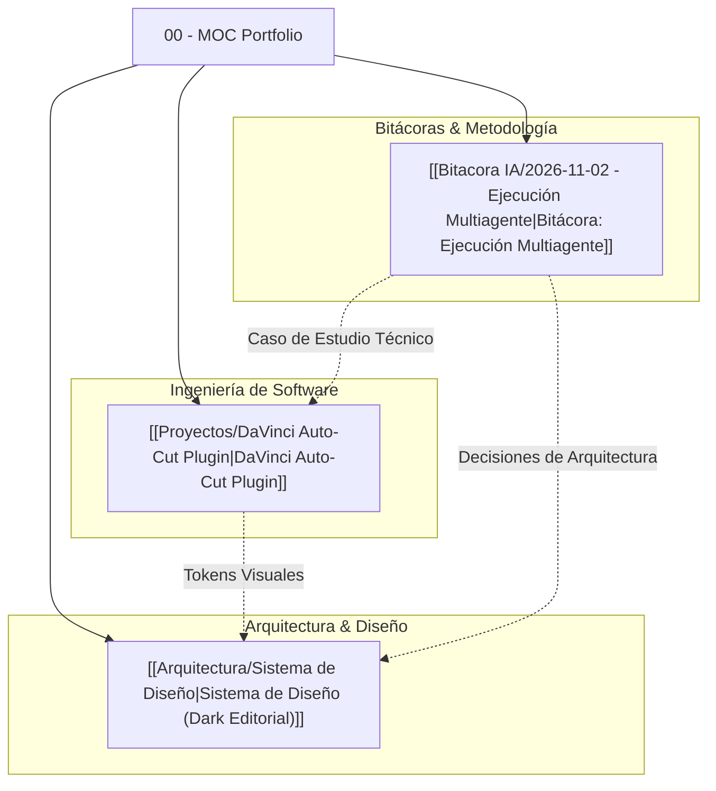

# 🗺️ 00 - Map of Content (MOC): Ecosistema Portfolio spukerrs

Bienvenido a la bóveda de documentación técnica y arquitectura del portfolio profesional de **Shair Fernando Cuello López** (`spukerrs`). Este repositorio de notas estructuradas en Obsidian documenta las decisiones de ingeniería, fundamentos de diseño visual, fichas de producto y registros académicos de desarrollo asistido por inteligencia artificial.

> *"La excelencia en el software moderno no radica en escribir código manualmente sin descanso, sino en poseer el criterio de arquitectura, la dirección de arte rigurosa y la capacidad de orquestar herramientas avanzadas para transformar problemas reales en soluciones de producción."*

---

## 📌 Índice General del Ecosistema

---

## 🏛️ 1. Arquitectura y Dirección de Arte

Fundamentos estructurales y visuales que rigen la interfaz del portfolio bajo la filosofía de ingeniería sobria **Dark Editorial**:

* **[[Arquitectura/Sistema de Diseño|Sistema de Diseño: Dark Editorial Engineering]]**
  * *Filosofía Anti-Slop Visual:* Erradicación de gradientes cliché de IA (púrpuras, azules saturados y brillos innecesarios).
  * *Tokens Semánticos:* Fondo `#090A0F`, Superficie `#11131A`, Bordes reactivos `rgba(255,255,255,0.08)`, Acento primario `#10B981` y secundario `#38BDF8`.
  * *Tipografía Dual:* `Plus Jakarta Sans` para lectura editorial de alta densidad + `JetBrains Mono` para telemetría técnica.
  * *Métricas de Calidad:* Cumplimiento estricto WCAG AAA, soporte completo `prefers-reduced-motion` y cero Cumulative Layout Shift (CLS < 0.1).

---

## ⚡ 2. Proyectos Destacados y Soluciones de Ingeniería

Fichas técnicas en profundidad de las herramientas desarrolladas, resolviendo problemas de fricción operativa mediante automatización:

* **[[Proyectos/DaVinci Auto-Cut Plugin|Proyecto: DaVinci Auto-Cut Plugin]]**
  * *El Problema:* Pérdida de horas en edición manual eliminando silencios y tomas muertas en timelines de video multicámara.
  * *Arquitectura:* Integración nativa entre Python 3, la API nativa de DaVinci Resolve (`DaVinciResolveScript`), `faster-whisper` (Silero VAD local a costo $0) y `FFmpeg`.
  * *Garantías:* Procesamiento 100% offline, latencia reducida en más del 70% y privacidad estricta de material audiovisual sin fuga de datos a la nube.

---

## 📓 3. Bitácoras de Desarrollo y Validación Académica

Registros formales de experimentación, gestión y orquestación multiagente en el marco académico y profesional:

* **[[Bitacora IA/2026-11-02 - Ejecución Multiagente|Bitácora IA: 2026-11-02 - Ejecución Multiagente]]**
  * *Filiación:* Shair Fernando Cuello López — 6.° Año de Informática, Instituto Privado Mixto San Agustín.
  * *Tema Central:* Orquestación de Agentes de Inteligencia Artificial en el Desarrollo de Software de Producción.
  * *Contenido:* Metodología de descomposición modular de tareas, prompt engineering para arquitecturas complejas, sincronización inter-agente y validación rigurosa de calidad.

---

## 🛠️ Matriz de Componentes del Sistema

| Módulo / Documento | Dominio Técnico | Estado | Enlace Rápido |
| :--- | :--- | :--- | :--- |
| **Sistema de Diseño** | UI/UX, Tokens Semánticos, WCAG | `En Producción` | [[Arquitectura/Sistema de Diseño]] |
| **DaVinci Auto-Cut** | Python, DaVinci API, VAD Local | `Fase Beta / Pruebas` | [[Proyectos/DaVinci Auto-Cut Plugin]] |
| **Bitácora Multiagente** | IA Agéntica, Metodología Escolar | `Presentado / Evaluado` | [[Bitacora IA/2026-11-02 - Ejecución Multiagente]] |

---

## 🔗 Enlaces Externos y Recursos del Entorno

* Repositorio del Portfolio: `https://github.com/spukerrs/portfolio`
* Código de Datos Desacoplado: `src/data/portfolio.ts`
* Despliegue en Producción: Vercel Cloud Platform
* Contacto Profesional: `cuello.shair@gmail.com`
