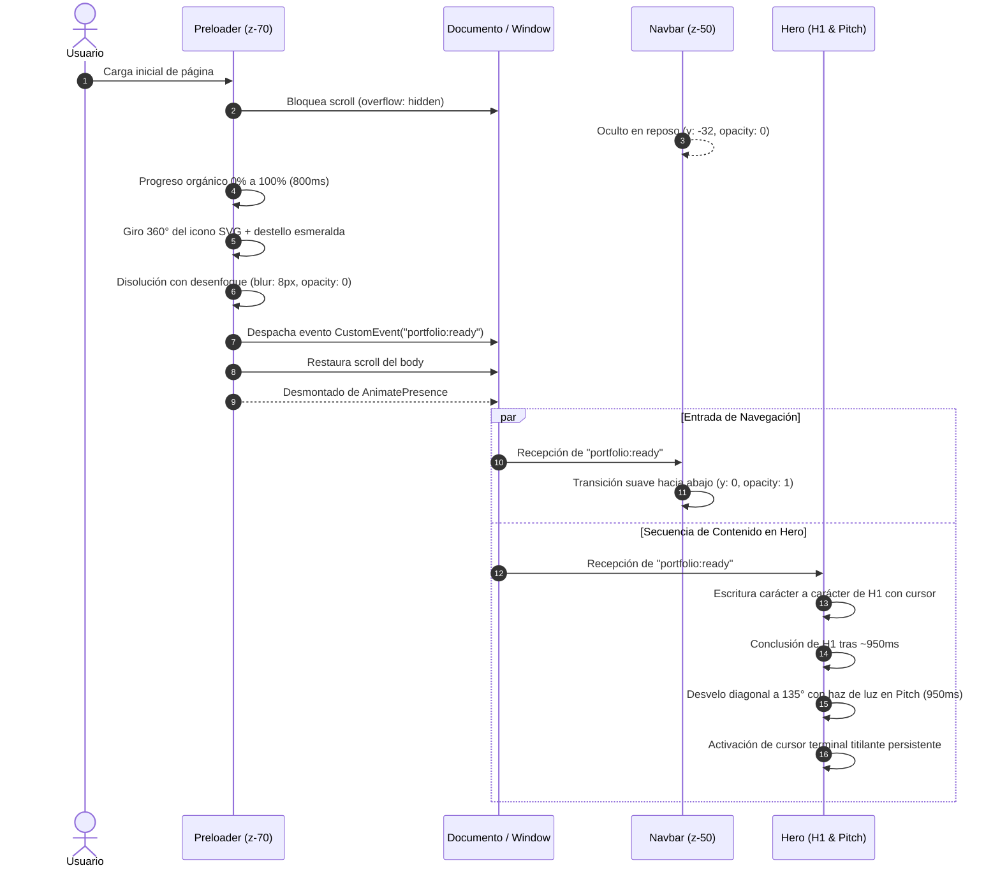

# Arquitectura de Entrada: Coreografía Visual, Preloader y Microinteracciones

Este documento detalla la ingeniería detrás de la secuencia de entrada, la pantalla de carga (*Preloader*), la sincronización desacoplada de la barra de navegación y las microinteracciones de desvelo en el encabezado principal del portfolio de **Shair Fernando Cuello López** (`spukerrs`).

> **Enlace al Mapa de Contenidos:** [[00 - MOC Portfolio]]  
> **Sistema de Diseño Base:** [[Arquitectura/Sistema de Diseño]]  
> **Archivos de Producción:** `src/components/ui/Preloader.tsx`, `src/components/layout/Navbar.tsx`, `src/components/sections/Hero.tsx` y `src/app/globals.css`

---

## 1. Fundamentos y Objetivos de la Experiencia

El ingreso al portfolio busca transmitir la identidad técnica de un *AI Product Builder & Creative Technologist*: rigor, precisión de software y estética sobria (*Dark Editorial*), evitando animaciones lentas o genéricas.

### Principios Rectores:
1. **Cero bloqueo prolongado:** La pantalla de carga previa no excede los 1.25 segundos. Proporciona una transición deliberada sin cansar al usuario recurrente.
2. **Cero Cumulative Layout Shift (CLS = 0):** Ninguna animación de tipeo o desvelo altera las dimensiones estructurales de los contenedores. El espacio se calcula previamente en el DOM, impidiendo saltos visuales en tarjetas o botones inferiores.
3. **Desacople mediante eventos de ventana:** La comunicación entre la pantalla de carga y los componentes visuales (Navbar y Hero) no ensucia la raíz del servidor ni requiere contextos pesados; se rige por un canal nativo `portfolio:ready`.
4. **Accesibilidad y Movimiento Reducido:** Cumplimiento total de `prefers-reduced-motion: reduce`. Cuando el usuario tiene activa esta preferencia, se omiten giros y demoras, presentando el contenido de forma inmediata.

---

## 2. Diagrama de Coreografía y Flujo Temporal

La siguiente secuencia describe el ciclo de vida desde la llegada del usuario al sitio:

---

## 3. Componentes de la Implementación

### 3.1. Pantalla de Carga Previa (`Preloader.tsx`)
* **Ubicación de Capa:** `fixed inset-0 z-[70] bg-[#090a0f]`.
* **Iconografía:** Reproducción en SVG a alta resolución del favicon del proyecto (rectángulo con borde sutil, símbolo de prompt terminal `>` en `#f3f4f6` y nodo esmeralda `#10b981`).
* **Telemetría de Carga:** Barra de progreso milimétrica con incrementos estocásticos controlados entre 10% y 24% cada 45ms.
* **Giro de Culminación:** Al alcanzar el 100%, la tarjeta ejecuta una rotación completa de 360 grados (`rotate: 360`) con curva de rebote sutil (`cubic-bezier(0.34, 1.56, 0.64, 1)`) acompañada de un halo expansivo esmeralda (`blur-xl`).

### 3.2. Despliegue de la Barra de Navegación (`Navbar.tsx`)
* **Estado Inicial:** Oculta en el borde superior (`y: -32px`, `opacity: 0`).
* **Sincronización:** Escucha activa del evento `portfolio:ready` con temporizador de respaldo de seguridad (1350ms) en caso de omisión.
* **Entrada:** Animación con física amortiguada (`duration: 0.55s`, curva `cubic-bezier(0.23, 1, 0.32, 1)` y retardo de 80ms tras la retirada del preloader).

### 3.3. Título Principal Tipo Terminal (`Hero.tsx`)
* **Tipeo Ágil:** Cadencia de 22ms por carácter en el texto principal `"AI Product Builder & Creative Technologist"`, con micropausas en espacios (28ms) y operadores (45ms).
* **Degradado Editorial:** Conservación de la textura cromática de gradiente en `"Creative Technologist"` sin interrupciones durante la escritura.
* **Cursor Activo:** Barra vertical esmeralda con resplandor (`shadow-[0_0_12px_rgba(16,185,129,0.9)]`) que acompaña el frente de escritura.

### 3.4. Revelado Diagonal con Haz de Brillo en el Manifiesto (`Hero.tsx` & `globals.css`)
* **Técnica:** Sustitución del tipeo letra por letra (que resultaba extenso para un párrafo de 318 caracteres) por un desvelo direccional de 135 grados.
* **Máscara CSS:** Clase `.diagonal-reveal-mask` con `-webkit-mask-size: 300% 300%` transitando desde posición `100% 100%` a `0% 0%`.
* **Haz de Luz:** Superposición `.animate-diagonal-shine` con gradiente lineal a 135° (`transparent -> esmeralda -> blanco especular -> esmeralda -> transparent`), barriendo el contenedor en exacta sincronización.
* **Cursor Terminal Persistente:** Al concluir el barrido de luz, se activa la regla `.animate-cursor-blink` al final del párrafo, simulando un prompt listo para interacción continua.

---

## 4. Auditoría de Calidad y Rendimiento

| Criterio | Estándar Exigido | Resultado Alcanzado | Verificación |
| :--- | :--- | :--- | :--- |
| **Cumulative Layout Shift** | CLS < 0.1 | **CLS = 0.000** | Dimensiones pre-calculadas en DOM |
| **Tiempo hasta Interactividad** | TTI < 2.5s | **~1.6s** | Preloader ligero (sin librerías pesadas) |
| **Accesibilidad ARIA** | WCAG AAA | **Conforme** | Textos en `sr-only` y decoraciones en `aria-hidden` |
| **Preferencia de Movimiento** | Reducción de mareo | **Conforme** | `useReducedMotion` desactiva transiciones |
| **Errores en Consola** | 0 warnings | **0 warnings / 0 errores** | Lint y compilador TypeScript sin fallas |
