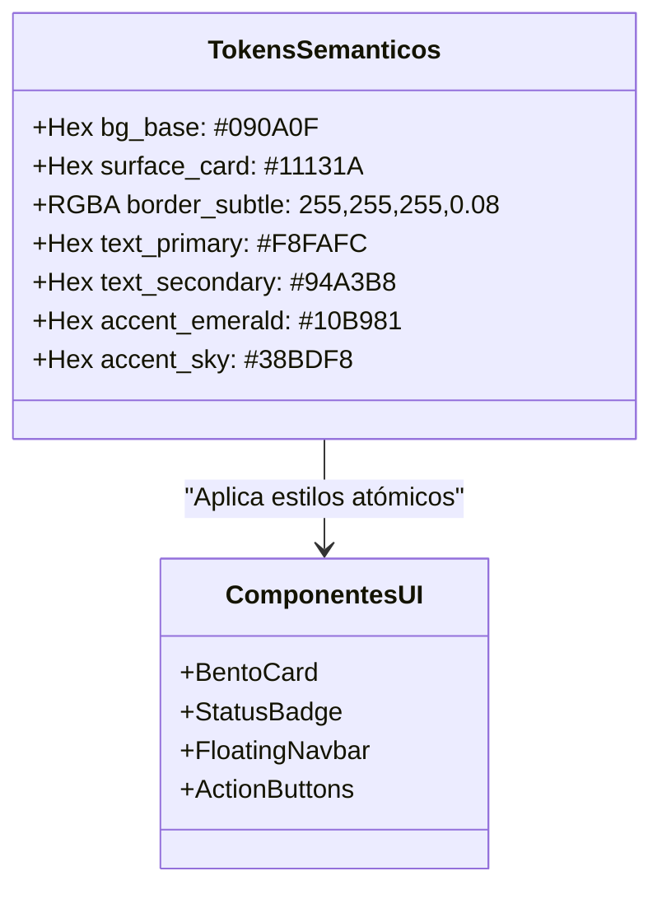

# 🎨 Sistema de Diseño: Dark Editorial Engineering

El sistema visual del portfolio de Shair Fernando Cuello López se basa en el paradigma **Dark Editorial Engineering**. Este enfoque sintetiza la sobriedad tipográfica del diseño editorial suizo con la precisión funcional de las interfaces de ingeniería contemporáneas (como Linear, Raycast o Vercel), erradicando deliberadamente el arquetipo visual cliché y descuidado atribuido a la inteligencia artificial generativa (*AI Slop*).

> **Enlace al Mapa de Contenidos:** [[00 - MOC Portfolio]]  
> **Implementación en Producción:** `src/app/globals.css` y `src/data/portfolio.ts`  
> **Casos de Aplicación:** [[Proyectos/DaVinci Auto-Cut Plugin]] · [[Bitacora IA/2026-11-02 - Ejecución Multiagente]]

---

## 🚫 1. Principio Rector: Anti-Slop Visual

El ecosistema digital actual sufre de una proliferación de interfaces sintéticas clónicas: fondos oscuros genéricos inundados de gradientes morados (`#8B5CF6`) y cianes saturados (`#06B6D4`), tarjetas con bordes fluorescentes sin significado funcional y animaciones excesivas que degradan la experiencia de usuario.

### Directrices de Erradicación:
1. **Cero degradados cliché no justificados:** Se prohíbe el uso de `from-purple-500 to-blue-500`. El color debe comunicar telemetría, estado de ejecución o jerarquía de lectura, no relleno ornamental.
2. **Jerarquía por luminancia y no por saturación:** La diferenciación de capas de profundidad se logra mediante modulaciones milimétricas de valor lumínico sobre escala de grises fríos, no encandilando al usuario.
3. **Bordes estructurales de alta precisión:** Delimitación física de `1px` con opacidad calibrada (`rgba(255, 255, 255, 0.08)`), que reacciona suavemente al hover del puntero a `rgba(255, 255, 255, 0.18)` sin crear halos de luz desmedidos.

---

## 🎨 2. Tokens Semánticos de Color

El sistema de tokens está implementado mediante variables CSS nativas consumidas por Tailwind CSS v4, garantizando una fuente única de verdad para el renderizado.

| Token Semántico | Valor Hex / RGBA | Uso Primario | Relación de Contraste |
| :--- | :--- | :--- | :--- |
| `--bg-base` | `#090A0F` | Fondo principal (Negro obsidiana de absorción) | Fondo base (0:0) |
| `--surface-card` | `#11131A` | Superficie de tarjetas Bento, contenedores y paneles | Elevación Nivel 1 |
| `--surface-elevated`| `#171923` | Modales, tooltips flotantes y menús desplegables | Elevación Nivel 2 |
| `--border-subtle` | `rgba(255, 255, 255, 0.08)` | Delimitadores de rejilla, divisores horizontales | Estructura sutil |
| `--border-hover` | `rgba(255, 255, 255, 0.18)` | Realce en hover e interacción focal | Feedback táctico |
| `--text-primary` | `#F8FAFC` | Títulos Display, H1, H2 y datos cuantitativos | **18.2:1 (Supera WCAG AAA)** |
| `--text-secondary`| `#94A3B8` | Cuerpo de texto editorial, descripciones y contexto | **7.1:1 (Supera WCAG AAA)** |
| `--accent-primary` | `#10B981` | Verde esmeralda: Estado online, tags de producción | **8.4:1 sobre `#090A0F`** |
| `--accent-secondary`| `#38BDF8` | Azul cielo: Enlaces externos, pipelines y APIs | **7.8:1 sobre `#090A0F`** |



---

## 🔤 3. Sistema Tipográfico Dual

El emparejamiento tipográfico combina una tipografía sans-serif humanista y geométrica para prosa y lectura, con una tipografía monoespaciada de alta legibilidad para el universo técnico:

### A. Tipografía de Interfaz: `Plus Jakarta Sans`
* **Rol:** Títulos principales, navegación, encabezados de tarjeta y texto narrativo.
* **Escala y Espaciado:**
  * *Display / Hero:* `text-4xl` a `text-6xl`, peso `font-bold` (700/800), `tracking-tight` (`-0.03em`) y `leading-[1.1]`.
  * *H2 / Subtítulos:* `text-2xl` a `text-3xl`, peso `font-semibold` (600), `tracking-tight` (`-0.02em`).
  * *Body:* `text-base` (16px) y `text-sm` (14px), peso `font-normal` (400), `leading-relaxed` (`1.6`).
* **Propósito:** Proporciona un carácter moderno, limpio y editorial que evita la frialdad corporativa sin caer en informalidad.

### B. Tipografía de Ingeniería: `JetBrains Mono`
* **Rol:** Telemetría de proyectos, chips de tecnologías (`Python`, `Next.js`, `FFmpeg`), métricas cuantitativas, marcas de tiempo y etiquetas de estado.
* **Escala y Espaciado:**
  * *Micro-etiquetas:* `text-xs` (12px), `font-medium` (500), `tracking-wide` (`0.05em`), `uppercase`.
  * *Fragmentos de código:* `text-sm` (14px), ligado a bloques de sintaxis claros.
* **Propósito:** Comunica autenticidad y solvencia técnica. Refleja que el producto fue construido por un ingeniero y creador de herramientas.

---

## ♿ 4. Accesibilidad y Estándares WCAG AAA

La accesibilidad no es un añadido superficial, sino una restricción de ingeniería integrada en la concepción del código:

1. **Ratios de Contraste Innegociables:**
   * Todo texto principal sobre superficie o fondo base supera los `18:1`, excediendo holgadamente el mínimo de `7.0:1` exigido por **WCAG AAA**.
   * Los acentos interactivos y estados de foco mantienen ratios superiores a `4.5:1` para elementos interactivos esenciales.

2. **Navegación por Teclado y Foco Visible:**
   * Ningún elemento interactivo suprime el contorno sin reemplazo.
   * Patrón de foco global aplicado:
     ```css
     focus-visible:outline-none focus-visible:ring-2 focus-visible:ring-[#10B981] focus-visible:ring-offset-2 focus-visible:ring-offset-[#090A0F]
     ```

3. **Semántica ARIA Rigurosa:**
   * Todos los botones con contenido exclusivamente iconográfico (como enlaces a GitHub o LinkedIn) incluyen obligatoriamente atributos `aria-label` descriptivos y/o etiquetas accesibles ocultas para lectores de pantalla (`sr-only`).

---

## ⚡ 5. Rendimiento y Física de Animación (60 FPS)

Siguiendo las directrices de animación física y rendimiento:

* **Propiedades Permitidas:** Exclusivamente propiedades aceleradas por la GPU (`transform`, `opacity`). Prohibido animar `height`, `width`, `margin` o `top` para evitar costosos *layout reflows*.
* **Preservación de Cuadros (60 FPS):** Transiciones ligeras de entre 150ms y 300ms con curvas elásticas calibradas (`easeOut` suave).
* **Respeto a Preferencias del Sistema:** Toda animación compleja se envuelve bajo la media query de accesibilidad `motion-safe:` o degrada a transiciones instantáneas si el usuario activó `prefers-reduced-motion`.
* **Zero Cumulative Layout Shift (CLS < 0.1):**
  * Espacio explícito reservado para visualizadores y mockups abstractos.
  * Fuentes web precargadas mediante `next/font/google` con `display: swap` y métricas de tamaño adaptadas para evitar saltos de texto (*FOUT/FOIT*).

---

## 🧱 6. Componentes del Sistema

### A. Tarjeta Bento Editorial (`BentoCard`)
* **Contenedor:** `bg-[#11131A]`, borde `1px solid rgba(255,255,255,0.08)`, radio `rounded-2xl`, relleno interno uniforme `p-6` a `p-8`.
* **Comportamiento Hover:** Incremento sutil de luminosidad en el borde a `rgba(255,255,255,0.18)` y traslación vertical milimétrica (`translate-y-[-2px]`).

### B. Badge de Telemetría / Estado (`StatusBadge`)
* Contenedor en píldora con fondo sutil translúcido (`bg-[#10B981]/10`), borde esmeralda tenue (`border-[#10B981]/20`) y punto pulsante animado (`animate-pulse`) que comunica actividad en tiempo real.

### C. Botón de Acción Táctica (`ActionButton`)
* **Primario:** Fondo `#F8FAFC`, texto `#090A0F`, radio ergonómico `rounded-xl`, tipografía `font-medium`, contraste total.
* **Secundario / Outline:** Fondo transparente o translúcido, borde `1px solid rgba(255,255,255,0.12)`, texto `#F8FAFC`, efecto hover con iluminación reactiva.

---

## 🔗 Referencias Cruzadas

* Volver al índice: [[00 - MOC Portfolio]]
* Ver el proyecto estrella construido bajo este sistema: [[Proyectos/DaVinci Auto-Cut Plugin]]
* Ver el registro de decisiones y orquestación: [[Bitacora IA/2026-11-02 - Ejecución Multiagente]]
