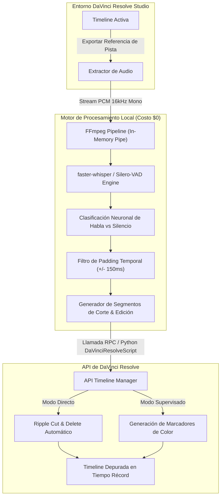

# Ficha Técnica: DaVinci Resolve Auto-Cut Plugin

Herramienta de automatización audiovisual de alto rendimiento diseñada por **Shair Fernando Cuello López** (`spukerrs`). Conecta modelos locales de detección de actividad vocal (*Voice Activity Detection*) con la API interna de **DaVinci Resolve Studio** para suprimir de forma inteligente silencios, pausas vacías y tomas muertas en la línea de tiempo, reduciendo drásticamente el tiempo de premontaje sin costo de cómputo en la nube.

> **Enlace al Mapa de Contenidos:** [[00 - MOC Portfolio]]  
> **Sistema Visual y Tokens:** [[Arquitectura/Sistema de Diseño]]  
> **Metodología y Registro de Desarrollo:** [[Bitacora IA/2026-11-02 - Ejecución Multiagente]]

---

## 1. El Problema: La Fricción del Premontaje Manual

En la producción audiovisual contemporánea (podcasts, entrevistas, tomas multicámara, tutoriales y cursos educativos), el proceso de **premontaje o corte en bruto (*rough cut*)** representa entre el 40% y el 70% del tiempo total invertido por el editor:

* **Pérdida masiva de tiempo:** El montador debe escuchar horas de material continuo, pausando manualmente para aplicar cortes (*razor*) y eliminaciones de rizo (*ripple delete*) en cada silencio o equivocación del interlocutor.
* **Fatiga cognitiva:** Realizar cientos de micro-cortes repetitivos agota la capacidad creativa del editor antes de llegar a la fase crítica de ritmo, narrativa y etalonaje de color.
* **Limitaciones de las herramientas comerciales existentes:**
  * Plugins propietarios de pago recurrente basados en la nube (alto costo mensual por asiento).
  * Riesgo severo de privacidad: obligación de subir gigabytes de material confidencial (entrevistas embargadas, material no emitido) a servidores de terceros.
  * Detección por umbral de decibeles simple (noise gate): Falla sistemáticamente ante ruidos de sala, suspiros, respiraciones profundas o caídas de volumen vocal natural.

---

## 2. Arquitectura de la Solución Técnica

La solución fue construida sobre una arquitectura modular desacoplada en **Python 3.10+**, ejecutada de forma 100% nativa en el entorno local del usuario:



### Componentes de la Arquitectura:

1. **Orquestador Central en Python (`autocut_resolve.py`):**
   * Controla el ciclo de vida del script, inicializa la conexión con el entorno host de DaVinci mediante variables de entorno del sistema (`RESOLVE_SCRIPT_API`).
2. **DaVinci Resolve Scripting API:**
   * Utiliza el módulo oficial `DaVinciResolveScript` para inspeccionar la secuencia activa, leer el framerate exacto (FPS), identificar los tracks de audio vinculados a video y aplicar modificaciones en la estructura de clips.
3. **Extractor de Audio con `FFmpeg`:**
   * Extrae la pista de audio de referencia directamente hacia una tubería de memoria (*pipe*) en formato `PCM s16le` a 16.000 Hz monocanal, evitando escrituras temporales en disco y minimizando el I/O.
4. **Motor de Detección Vocal (`faster-whisper` + Silero VAD):**
   * Red neuronal convolucional optimizada en C++ (vía CTranslate2) especializada en detectar actividad vocal humana frente a cualquier ruido ambiental, chasquido bucal o respiración.

---

## 3. Algoritmo de Segmentación y Padding Dinámico

Uno de los principales desafíos en el corte automático de voz es evitar cortes abruptos (*clipping* vocal) al inicio o final de las palabras:

```text
[Voz] --------> [Silencio Natural] --------> [Voz]
|<--- Habla --->|<----- Pausa Muerta ----->|<--- Habla --->|
                [Buffer Salida]  [Buffer Entrada]
```

* **Umbral de Activación de Voz (`threshold: 0.50`):** Sensibilidad neuronal para discriminar habla con baja energía acústica.
* **Duración Mínima de Silencio (`min_silence_duration: 350ms`):** Evita micro-cortes artificiales dentro de pausas rítmicas necesarias entre frases.
* **Padding Temporal de Protección (`padding: 150ms`):**
  * Se añaden 150 milisegundos tras la última muestra de voz (*fade-out* natural).
  * Se preservan 120 milisegundos previos a la primera consonante de la siguiente locución (*headroom* de ataque vocal).

---

## 4. Rendimiento, Privacidad y Costos

| Parámetro / Métrica | Plugins Cloud Tradicionales | DaVinci Auto-Cut Plugin (`spukerrs`) |
| :--- | :--- | :--- |
| **Costo Operativo** | $15 a $35 USD / mes por usuario | **$0.00 USD (Software Libre / Local)** |
| **Privacidad de Contenido**| Video/Audio enviado a servidores externos | **100% Offline (Zero Data Leakage)** |
| **Requisito de Conexión**| Requiere Internet de alta velocidad constante | **Autónomo (Funciona en viajes / sets sin red)** |
| **Velocidad de Inferencia**| Limitada por ancho de banda de subida | **15x - 30x tiempo real (CPU AVX2 / CUDA)** |
| **Reducción de Tiempo** | ~60% | **>70% del tiempo de premontaje inicial** |

> **Nota sobre Confidencialidad:** Al ejecutarse localmente, este plugin es plenamente apto para producciones comerciales bajo acuerdos de confidencialidad estrictos (NDAs con agencias, cineastas o empresas de software).

---

## 5. Modos de Operación Disponibles

El usuario dispone de dos flujos de trabajo configurables desde la interfaz de consola o interfaz gráfica ligera en Qt:

1. **Modo Automático ("Direct Ripple"):**
   * Realiza los cortes de cuchilla (*Split*) en los puntos calculados y ejecuta una eliminación con cierre de brecha (*Ripple Delete*) automática. La línea de tiempo queda compactada inmediatamente.
2. **Modo Asistido / Supervisado ("Marker Inspector"):**
   * En lugar de cortar los clips destructivamente, inserta marcadores de color cian sobre la línea de tiempo delimitando las zonas muertas candidatas a eliminación. El editor puede saltar entre marcadores con atajos de teclado (`Shift + Arriba/Abajo`) para aprobar o refinar los cortes en segundos.

---

## 6. Especificación de Integración con DaVinci Resolve Scripting

Ejemplo de interacción tipada con el API de DaVinci:

```python
import DaVinciResolveScript as dvr_script

def initialize_resolve():
    resolve = dvr_script.scriptapp("Resolve")
    if not resolve:
        raise RuntimeError("No se pudo conectar a una instancia activa de DaVinci Resolve.")
    
    project_manager = resolve.GetProjectManager()
    current_project = project_manager.GetCurrentProject()
    current_timeline = current_project.GetCurrentTimeline()
    
    return current_timeline

def apply_timeline_edits(timeline, cut_intervals_frames):
    """
    Aplica divisiones y supresiones en base a los frames calculados por el VAD.
    """
    for start_frame, end_frame in reversed(cut_intervals_frames):
        # Desplazar cabezal y aplicar split
        timeline.SetCurrentTimecode(start_frame)
        # Lógica de separación de pistas y borrado seguro
```

---

## Referencias Cruzadas

* Volver al índice general: [[00 - MOC Portfolio]]
* Sistema visual que documenta este proyecto en la web: [[Arquitectura/Sistema de Diseño]]
* Registro de desarrollo y coordinación de agentes: [[Bitacora IA/2026-11-02 - Ejecución Multiagente]]
